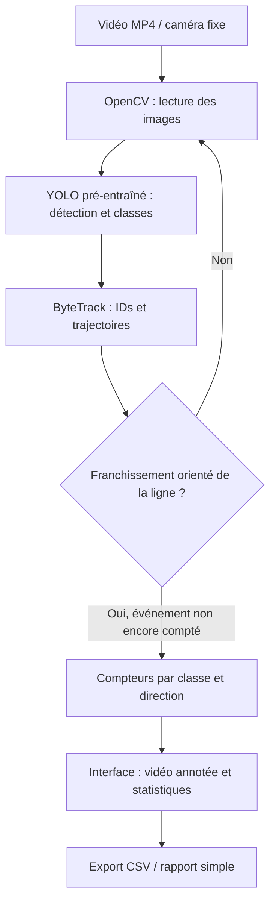

# Étude de conception — Projet 8 : Comptage de véhicules avec YOLO pré-entraîné

**Cours :** Développement et déploiement d'applications intelligentes (S2)  
**Projet :** 8 — Comptage de véhicules avec YOLO pré-entraîné  
**Groupe :** [Ayoub BELOUANAS & Youness LAKBAB & Mohamed NEJJARI & Oussama BANANI]   
**Version :** Brouillon (sections 1 à 5) — à compléter en version finale  
**Date :** [11/10/2026]

> **Consigne du projet (diapositive) :** livrer un prototype fonctionnel intégrant un composant de Machine Learning, une interface, des tests, une documentation, et une procédure de déploiement. L'ajout d'un assistant RAG est optionnel.  
> **Choix de conception :** utiliser un modèle YOLO pré-entraîné pour détecter les véhicules, un algorithme de suivi pour conserver leur identité, puis un franchissement de ligne virtuelle pour les compter. **Aucun fine-tuning n'est prévu dans la première version** : il sera envisagé uniquement si l'évaluation montre des défauts de détection importants.

## 1. Contexte et utilisateurs

### Organisation ou situation

Dans le suivi d'une voie de circulation, le comptage manuel des véhicules est long et sujet aux erreurs. Nous proposons une application qui analyse une vidéo de trafic (fichier MP4, puis éventuellement caméra fixe), détecte les véhicules et produit des statistiques de passages.

### Utilisateur principal (rôle précis)

Le **gestionnaire de trafic d'un site ou d'un axe routier** importe une vidéo et consulte le nombre de véhicules ayant traversé une ligne virtuelle pendant la période filmée. Il peut ainsi comparer les volumes de trafic entre deux périodes. Un étudiant ou un évaluateur peut également utiliser l'application pour tester les résultats du prototype.

## 2. Problème et décision

- **Décision soutenue :** déterminer si un créneau présente un volume de trafic élevé ou faible, et identifier la répartition des passages par catégorie (voiture, moto, bus, camion), afin de prioriser une analyse ou une intervention humaine.
- **Fréquence :** à chaque analyse d'une vidéo ; possibilité ultérieure d'analyses quotidiennes à partir d'une caméra fixe.
- **Conséquence d'une erreur et personnes concernées :** un sous-comptage masque une circulation réelle importante ; un surcomptage exagère le trafic. Ces erreurs affectent le gestionnaire utilisant les chiffres et potentiellement les usagers si une décision de gestion est fondée uniquement sur des statistiques incorrectes. Dans ce prototype, **aucune action de circulation n'est automatisée**.

## 3. Approche par sous-problème

| Sous-problème | Approche | Justification / pourquoi pas plus simple ? |
|---|---|---|
| Lire la vidéo | Règles / OpenCV | Outil standard suffisant, sans apprentissage. |
| Localiser et classifier les véhicules | **Deep Learning : YOLO pré-entraîné** | Une simple soustraction de fond est sensible aux ombres, aux changements d'éclairage et ne distingue pas les classes de véhicules. |
| Maintenir l'identité du véhicule entre images | Algorithme de tracking, **ByteTrack** ou BoT-SORT | Des détections indépendantes image par image provoqueraient un double comptage. |
| Décider si un véhicule doit être compté | **Règle géométrique** : franchissement orienté d'une ligne virtuelle par un identifiant suivi | Une règle explicite suffit ; aucun autre modèle ML n'est requis. |
| Calculer et afficher les totaux | Règles + interface | Addition des passages et présentation des résultats. |
| Répondre à des questions sur la documentation (optionnel) | RAG | Non nécessaire au comptage ; hors du périmètre initial. |

**Échelle de la décision :** **véhicule individuel** (compter ou non un passage) puis **agrégation à l'échelle d'une vidéo / période** (statistiques). Les détections portent sur des objets, pas sur l'identité des conducteurs.

**Fine-tuning :** nous commençons avec les poids pré-entraînés. Si le modèle échoue souvent sur des véhicules petits, partiellement masqués ou des prises de vue spécifiques, nous constituerons un jeu d'images annotées et comparerons une version ajustée au modèle initial. Ce travail reste optionnel et ne remplacera pas l'évaluation de la logique de tracking/comptage.

## 4. Données

| Jeu de données | Source envisagée | Volume prévu (objectif) | Licence / autorisation | Données personnelles ? |
|---|---|---|---|---|
| Modèle pré-entraîné et classes de véhicules | Poids YOLO compatibles avec Ultralytics, pré-entraînés sur des classes de type COCO | 1 jeu de poids ; pas de réentraînement initial | Vérifier les licences exactes du modèle, des poids et de la bibliothèque selon la version retenue | Non, pas de données personnelles fournies en entrée par notre groupe |
| Vidéos d'entrée et de démonstration | Captures autorisées par le groupe ou vidéos publiques avec réutilisation permise | 5 à 10 vidéos de 30 s à 3 min (cible initiale) | Relever la source et les droits de chaque vidéo avant utilisation | **Possiblement oui** : plaques, visages, lieux |
| Vérité terrain pour l'évaluation | Comptage et annotation manuels des franchissements par le groupe | Toutes les vidéos du jeu de test | Annotations produites par le groupe ; droits des vidéos sous-jacentes à respecter | Limiter aux identifiants anonymes, classe et passage |

**Choix de préparation :** une caméra fixe, une seule ligne de comptage, une direction définie et des classes `car`, `motorcycle`, `bus`, `truck` constituent le périmètre minimal. Les vidéos d'évaluation doivent inclure des situations simples et quelques difficultés (occlusions, densité de trafic, lumière variable). **Les sources réelles, licences et volumes observés seront renseignés avant la version finale.**

**Réduction des données personnelles :** privilégier des vidéos autorisées, limiter la conservation des vidéos brutes, ne pas reconnaître les plaques ni les visages et ne conserver que les statistiques si elles suffisent. Le floutage sera appliqué avant toute diffusion de vidéos reconnaissables lorsque nécessaire.

## 5. Métriques, baseline et critères d'acceptation

### Baseline à battre

- **Baseline simple :** comptage automatique à partir de la détection de mouvement et d'une ligne de franchissement (OpenCV, sans classification YOLO). Elle sera évaluée sur les mêmes vidéos pour comparaison.
- **Référence de vérité terrain (et non une baseline automatique) :** comptage manuel des véhicules qui franchissent la ligne, avec classe et sens de circulation.
- **Résultats actuels :** non mesurés au stade de la conception ; ne pas présenter de performance hypothétique comme résultat réel.

### Métrique principale et coût des erreurs

Pour chaque vidéo et sens de passage :

`Erreur absolue = |nombre compté par l'application - nombre réel annoté|`

`Erreur relative (%) = 100 × |nombre compté - nombre réel| / nombre réel`, calculée uniquement lorsque `nombre réel > 0`.

Une erreur de comptage a un coût opérationnel : les **passages oubliés** sous-estiment le trafic et les **doubles comptages** le surestiment. Ces deux erreurs seront rapportées séparément lors des tests.

### Métriques secondaires

- Précision et rappel des **événements de franchissement** après appariement avec la vérité terrain ;
- Erreur par classe de véhicule ;
- Nombre de franchissements comptés deux fois et de franchissements manqués ;
- Temps de traitement et FPS sur le matériel de test.

### Critères d'acceptation proposés (à vérifier expérimentalement)

1. **Erreur absolue totale moyenne ≤ 10 %** sur les vidéos de test contenant au moins un passage (moyenne des erreurs relatives par vidéo).
2. Pour chaque vidéo du jeu de test retenu, **erreur relative ≤ 20 %** ; les dépassements seront signalés comme échecs.
3. Les totaux des **quatre classes** (voiture, moto, bus, camion) sont affichés.
4. Une piste suivie ne déclenche pas plusieurs événements pour un même franchissement orienté de la ligne ; les doubles comptages observés sont mesurés.
5. L'utilisateur peut importer une vidéo, démarrer le traitement et consulter les résultats sans modifier le code.
6. Le système doit obtenir une erreur de comptage **inférieure à celle de la baseline OpenCV**, sur le même jeu de test.

**Protocole :** séparer les vidéos utilisées pour les réglages et celles utilisées pour les tests finaux ; figer la position de la ligne, le seuil de confiance et le tracker avant l'évaluation ; documenter le CPU/GPU et les versions des bibliothèques. Les valeurs ci-dessus sont des objectifs, non des performances garanties.

## 6. Architecture prévue (à finaliser après la séance 5)

La ligne virtuelle est réglée par l'utilisateur ou configurée pour la vidéo. Le suivi réduit le double comptage ; un ensemble d'événements déjà enregistrés empêche de compter plusieurs fois le même passage. Les cas de perte d'identifiant seront évalués : le tracker n'est pas infaillible.

## 7. Choix technologiques (à finaliser après la séance 5)

| Besoin | Outil envisagé | Justification |
|---|---|---|
| Programmation | Python | Écosystème ML et traitement vidéo. |
| Détection | YOLO pré-entraîné via Ultralytics | Modèle prêt à l'emploi ; détection multi-classes. |
| Traitement d'images | OpenCV | Lecture, dessin des lignes et annotations. |
| Suivi | ByteTrack (ou BoT-SORT) | Association des détections dans le temps. |
| Interface | Streamlit | Prototype accessible avec import de vidéo et indicateurs. |
| Stockage | CSV / fichiers locaux | Statistiques simples, sans base de données obligatoire. |
| Déploiement | Environnement Python avec `requirements.txt` et README ; conteneur Docker en option | Installation reproductible et démonstration locale. |
| Tests | pytest + petit jeu de vidéos annotées | Validation des règles de comptage et mesure de performance. |

Le prototype fonctionnera localement sans API externe obligatoire. Un GPU améliore les performances, mais le fonctionnement sur CPU pourra être testé avec un petit modèle YOLO.

## 8. Risques, éthique, confidentialité

| Question de la fiche | Réponse et mesure prévue |
|---|---|
| **1. Les données contiennent-elles des données personnelles ? Lesquelles ?** | Une vidéo peut montrer des plaques, visages, lieux et horaires. **Mesure :** sélectionner des vidéos autorisées et minimiser la conservation. |
| **2. Peut-on s'en passer ou les anonymiser ?** | Oui : seules les trajectoires anonymes et les totaux sont nécessaires. **Mesure :** pas de reconnaissance de plaques ; floutage des vidéos diffusées si nécessaire. |
| **3. Qui peut être lésé par une erreur ?** | Le gestionnaire et indirectement les usagers. **Mesure :** afficher des résultats vérifiables et signaler les limites. |
| **4. Les données couvrent-elles tous les cas d'usage (lieux, périodes, populations) ?** | Non : les premières vidéos ne couvriront probablement pas nuit, pluie, caméras mobiles et tous les types de voies. **Mesure :** tester plusieurs situations et documenter celles qui restent non couvertes. |
| **5. Quelle erreur coûte le plus, et à qui ?** | Un sous-comptage peut cacher une forte affluence ; un surcomptage peut induire une intervention injustifiée. **Mesure :** séparer faux passages et passages manqués et soumettre les décisions de gestion à un humain. |
| **6. Qui valide les décisions, et peut les corriger ?** | Le gestionnaire valide les chiffres au regard de la vidéo. **Mesure :** permettre la vérification, la correction manuelle et la relance avec une autre ligne ou configuration. |
| **7. Des données sortent-elles de l'organisation (API externe) ?** | Non dans le périmètre prévu : inférence locale. **Mesure :** ne pas envoyer les vidéos à un service tiers ; documenter tout changement. |
| **8. Comment le système pourrait-il être détourné ?** | Surveillance non autorisée ou suivi indirect des déplacements. **Mesure :** limiter aux comptes agrégés et contrôler l'accès aux vidéos et exports. |

## 9. Limites et hors périmètre

**Limites techniques :** occultations, éclairage faible, pluie, caméra instable, objets lointains, perte ou échange d'identifiants du tracker, détection de classes ambiguës et mauvais placement de la ligne virtuelle. Les mesures sur un petit échantillon ne garantissent pas les performances dans un autre environnement.

**Hors périmètre de la première version :** reconnaissance de plaques ou de personnes ; prédiction du trafic ; estimation certifiée de vitesse ; commande des feux ; déploiement à grande échelle ; entraînement complet du modèle ; **fine-tuning**, sauf si justifié par les tests ; **assistant RAG**, optionnel et non nécessaire au comptage.

---

## Livrables et déroulement du projet

Conformément à la diapositive du sujet, la livraison visée comprend :

- [ ] **Prototype fonctionnel** : chargement d'une vidéo, détection, tracking, comptage et résultats.
- [ ] **Interface** : import et consultation des statistiques.
- [ ] **Tests** : vidéos annotées, mesure de l'erreur, comparaison avec baseline.
- [ ] **Documentation** : `README.md`, méthode, paramètres, limites et résultats.
- [ ] **Procédure de déploiement** : installation, dépendances, lancement et exemple d'utilisation.
- [ ] **Optionnel — assistant RAG** : aide documentaire uniquement si le temps le permet.

### Organisation des séances

- **Avant la séance 3 :** soumettre les sections **1 à 5 en brouillon**.
- **Après la séance 5 :** stabiliser l'architecture (section 6) et les technologies (section 7).
- **Pour la séance 6 :** remettre les **9 sections en version finale**, avec données réellement utilisées, baseline calculée, résultats de tests, architecture et risques vérifiés.

